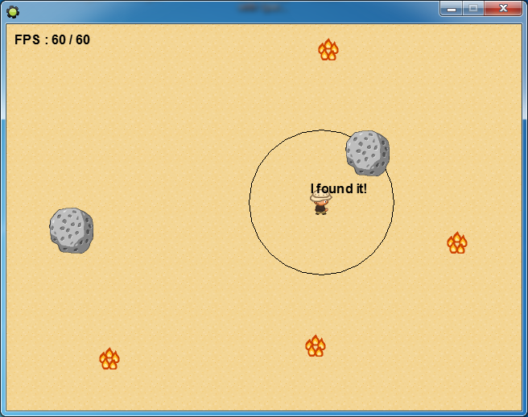

# InstanceNearest

[한국어](README.ko.md)

A C++ DLL for GameMaker that finds the nearest instance within a range, leaving out the caller itself. The coordinates of each object's instances are registered in a linked list, and a search walks that list comparing squared distances. Distance can be measured either between center points or to the bounding box, so the instance that is actually closer gets picked even when objects differ in size. It consists of the DLL, a GameMaker extension package, and an example.

<p>
  
</p>


## How to use

The archive from Releases contains the GameMaker 8 extension package `instance-nearest.gex` and the example project. Install the extension package and include it in a project.

Register an object first, then register that object's instances with their coordinates. To search, pass the reference position, your own id, and the range.

```gml
in_point_id_add(obj_enemy)                                   // register the object, once
with (obj_enemy) in_point_data_add(obj_enemy, x, y, id)      // register the instances

target = in_point_data_find(obj_enemy, x, y, id, 90)         // nearest within 90, or noone
```

| Function | Action |
|---|---|
| `in_point_id_add(objid)` | Registers an object |
| `in_point_data_add(objid, x, y, id)` | Registers an instance with its coordinates and id |
| `in_point_data_find(objid, x, y, id, distance)` | Returns the id of the nearest `objid` instance within `distance` of `(x, y)`, leaving out `id`. Returns `noone` if there is none |
| `in_point_data_reset(objid, id, x, y, id2)` | Changes the coordinates and id of a registered instance. Call it every step for instances that move |
| `in_point_data_delete(objid, id)` | Removes one instance |
| `in_point_data_clear(objid)` | Removes every instance of that object |
| `in_point_id_clear()` | Removes every registration |

Functions in the bounding box family have names starting with `in_bbox_` and also take the box coordinates, as in `in_bbox_data_add(objid, x, y, bbox_left, bbox_right, bbox_top, bbox_bottom, id)` and `in_bbox_data_reset(objid, id, x, y, bbox_left, bbox_right, bbox_top, bbox_bottom, id2)`. The other functions take the same arguments. The two families are independent, and `in_all_clear()` clears both.

In the example the arrow keys move a character. When a rock (bounding box family) or a fire (point family) comes within a radius of 90, I found it! appears above the character.


## How it works

**Each object has its own instance list.** Registered objects form a circular linked list, and each object node holds a circular linked list of its instances. A search finds the object node and walks only that list.

```cpp
typedef struct _OBJ
{
    struct _OBJ *next;
    struct _LIST *first, *last;
    double objid;
    INT8 list_check;
} OBJ;

typedef struct _LIST
{
    struct _LIST *next;
    double x, y, id;
} LIST;
```

**Distances are compared squared.** The range is squared first, then compared against the sum of the squared coordinate differences for each instance. No square root is ever computed. Each time a closer instance turns up, the range shrinks to that value, so the nearest one is what remains once the whole list has been walked.

```cpp
distance *= distance;
do{
    if(id!=Lbuffer->id)
    {
        distance_temp = pow(x - Lbuffer->x, 2) + pow(y - Lbuffer->y, 2);
        if(distance>distance_temp)
        {
            id_temp = Lbuffer->id;
            distance = distance_temp;
        }
    }
    Lbuffer = Lbuffer->next;
}while(Lbuffer != buffer->first);
```

**The bounding box distance is measured to the point where the box edge is crossed.** The search draws a line from the reference position to the instance center, tests it against the four box edges in turn, and compares using the distance to the first intersection it finds. A large object is caught when its edge is close even if its center is far. If the reference position is inside the box, the line crosses no edge and that instance is skipped.

**Every value is a double.** GameMaker passes only doubles to and from a DLL, so object ids, instance ids, and coordinates are all doubles. When nothing is found, -4 is returned, the same value as GameMaker's `noone`.


## Files

| Path | Content |
|---|---|
| `source/point_distance.cpp`, `source/point_distance.h` | Point distance family |
| `source/object_distance.cpp`, `source/object_distance.h` | Bounding box distance family |
| `source/clear.cpp`, `source/export.h` | Clear all and the export declaration |
| `source/InstanceNearest.dev`, `source/Makefile.win` | wxDev-C++ project and MinGW makefile |
| `docs/screenshots/` | Screenshots |
| Releases | Extension package and example |


## License

zlib. See [LICENSE](LICENSE).
